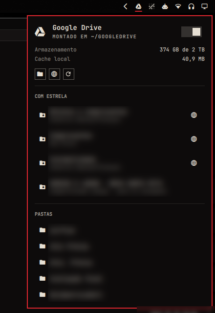

# Google Drive

[Português](README.md) · **English**

[Omarchy shell](https://omarchy.org) plugin for Google Drive mounted with `rclone`. The bar shows whether the Drive is mounted; the panel shows storage usage, your starred Drive folders and the top-level folders. Starred folders in My Drive open in the file manager; folders shared with you (outside the mount) open in the browser.



The panel interface is in Portuguese. The `gdrive` script follows your system language (Portuguese for `pt*`, English otherwise).

## Installation

```bash
omarchy plugin add https://github.com/LoganMerazzi/omarchy-gdrive.git --enable
~/.config/omarchy/plugins/logan.gdrive/extras/install.sh
```

`extras/install.sh`:

1. installs the `extras/gdrive` script as `~/.local/bin/gdrive`, which the panel uses to mount, open and edit;
2. installs `extras/rclone-gdrive.service` into `~/.config/systemd/user/`. It mounts the `gdrive:` remote at `~/GoogleDrive` with `--vfs-cache-mode full`;
3. runs `gdrive setup`: installs `rclone` if missing, optionally asks for your own OAuth client, creates the `gdrive` remote (opens the browser to authorize) and enables the service.

The rclone configuration, including the token, lives in `~/.config/rclone/rclone.conf`, outside the repository.

## Google client: default or your own?

With no extra setup, the plugin uses rclone's default OAuth client: just press Enter when `gdrive setup` asks for a Client ID. That client is shared by every rclone user, so:

- API rate-limit errors are common, and the Drive gets slow or shows folders as unreadable;
- rclone warns it will stop working during 2026.

For daily use, creating your own client in Google Cloud is recommended. It's free, takes about 10 minutes and gives you your own quota. The guide [docs/client-id.en.md](docs/client-id.en.md) covers the pros and cons, the step by step and the common errors (app stuck in Testing, "Publish app" grayed out, etc.).

To switch the client of an existing install:

```bash
gdrive client
```

## Requirements

- `rclone`, `fuse3`
- `curl`, used to build the paths of starred folders
- a file manager set as the default for `inode/directory` (Flea, Folio, Nautilus…). Folders open with `xdg-open`, so switching file managers needs no change in the plugin

## Updating

```bash
omarchy plugin update logan.gdrive && omarchy restart shell
```

If `extras/gdrive` changed in the update, run `extras/install.sh` again to refresh `~/.local/bin/gdrive`. It doesn't recreate the remote if it already exists.

## Privacy

See [PRIVACY.md](PRIVACY.md).
