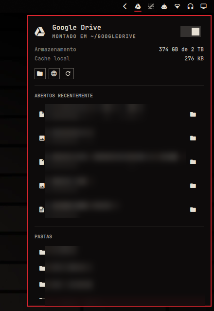

# Google Drive

Plugin do [Omarchy shell](https://omarchy.org) para o Google Drive montado com o `rclone`. Mostra na barra se o Drive está montado e, no painel, o espaço usado, as pastas e os arquivos abertos recentemente (lidos do cache VFS do rclone), com atalho para reabrir cada um para edição.



## Instalação

```bash
omarchy plugin add https://github.com/LoganMerazzi/omarchy-gdrive.git --enable
~/.config/omarchy/plugins/logan.gdrive/extras/install.sh
```

O `extras/install.sh`:

1. instala o script `extras/gdrive` em `~/.local/bin/gdrive`, que o painel usa para montar, abrir e editar;
2. instala `extras/rclone-gdrive.service` em `~/.config/systemd/user/`. Ele monta o remote `gdrive:` em `~/GoogleDrive` com `--vfs-cache-mode full`;
3. roda `gdrive setup`: instala o `rclone` se faltar, cria o remote `gdrive` (abre o navegador para autorizar) e ativa o serviço.

A configuração do rclone, com o token, fica em `~/.config/rclone/rclone.conf`, fora do repositório.

## Requisitos

- `rclone`, `fuse3`
- Nautilus, para abrir as pastas e "mostrar arquivo"

## Atualizar

```bash
omarchy plugin update logan.gdrive && omarchy restart shell
```
